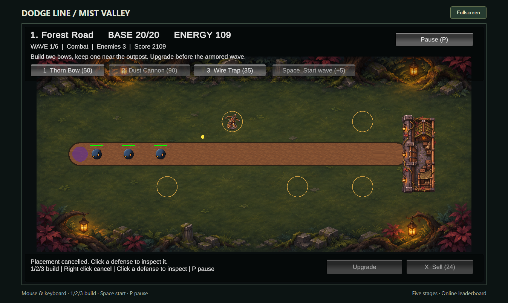

# Dodge Line — Mist Valley

Game thủ thành 2D dành cho chuột và bàn phím, được xây dựng bằng **Unity 6000.6.7f1** cho bài tập Game Programming. Bảo vệ tiền đồn trước các đợt quái, chọn vị trí phòng thủ và đối phó với những Wisp biết dự đoán đường đạn để lùi tránh.

**[Chơi trên trình duyệt](https://t-phongpham.github.io/DodgeLinePrototype/)** · [Hướng dẫn project](docs/SOLO_GAME_GUIDE.md) · [Thiết kế gameplay](docs/GDD.md)

## Cách chơi

1. Chọn màn đã mở khóa trong menu. Thắng một màn để mở màn tiếp theo.
2. Dùng energy để xây tháp trong **vòng vàng**. Mỗi vòng chứa một tháp; click trong vòng sẽ đặt tháp đúng tâm.
3. Đặt Wire Trap trên đoạn đường hợp lệ để làm chậm quái. Bẫy không cản đường và không cần vòng vàng.
4. Bắt đầu wave, nâng cấp phòng thủ và tiêu diệt toàn bộ quái trước khi căn cứ hết **20 HP**.

Quái chạm căn cứ sẽ dừng lại và đánh liên tục cho đến khi bị tiêu diệt. Thua khi căn cứ hết HP; thắng khi vượt qua toàn bộ wave của màn.

## Điều khiển

| Thao tác | Chức năng |
| --- | --- |
| `1` | Chọn Thorn Bow |
| `2` | Chọn Dust Cannon — mở từ màn 2 |
| `3` | Chọn Wire Trap |
| Chuột trái | Đặt phòng thủ; khi không xây, chọn phòng thủ để xem thông tin |
| Chuột phải | Hủy xây hoặc bỏ chọn phòng thủ; không bật menu trình duyệt trong vùng game |
| `U` | Nâng cấp tháp đang chọn, tối đa cấp 3 |
| `X` | Bán phòng thủ đang chọn, hoàn 70% energy đã chi |
| `Space` | Bắt đầu wave sớm trong thời gian chuẩn bị, nhận thêm 5 energy |
| `P` / `Esc` | Tạm dừng hoặc tiếp tục; `Esc` ưu tiên hủy chế độ xây nếu đang xây |
| `R` | Chơi lại màn hiện tại |

Nếu bàn phím chưa nhận, click vào khung game để lấy focus. Bản Web dành cho trình duyệt desktop; chưa hỗ trợ điều khiển cảm ứng.

## Phòng thủ và kẻ địch

| Phòng thủ | Vai trò | Giá xây |
| --- | --- | ---: |
| Thorn Bow | Bắn đạn đơn, chọn mục tiêu và bắn đón theo chuyển động | 50 |
| Dust Cannon | Bắn đạn nổ gây sát thương vùng, hữu ích với nhóm quái | 90 |
| Wire Trap | Làm chậm 50% trong 2 giây, tối đa 6 quái khác nhau | 35 |

- **Runner:** di chuyển nhanh, gây áp lực lên tuyến cuối.
- **Retreat Wisp:** cảnh báo vàng khi phát hiện đạn nguy hiểm và có thể lùi nếu đủ khoảng trống. Wisp vẫn nhận sát thương khi đang né.
- **Iron Guard:** di chuyển chậm, nhiều HP và có giáp giảm sát thương.

Đạn thực sự bay và va chạm; tháp không bảo đảm bắn trúng mục tiêu đang đổi hướng. Trap không tác động lên quái đã đứng đánh căn cứ.

## Chiến dịch

| Màn | Bối cảnh | Wave |
| --- | --- | ---: |
| 1 | Forest Road | 6 |
| 2 | Twilight Crossing | 8 |
| 3 | Ancient Garden | 8 |
| 4 | Amber Quarry | 9 |
| 5 | Moonlit Sanctuary | 10 |

Mỗi màn bắt đầu với energy và phòng thủ mới. Sao dựa trên HP còn lại: **18–20 HP: 3 sao**, **10–17 HP: 2 sao**, **1–9 HP: 1 sao**. Điểm trận = `100 × HP còn lại + energy còn lại + 10 × số quái tiêu diệt`.

## Leaderboard và lưu tiến trình

Module network dùng **Unity Gaming Services Authentication + Leaderboards**, trao đổi qua HTTPS. Mỗi màn có bảng điểm riêng và giữ kết quả tốt nhất. Mở **Online leaderboard**, lưu tên hiển thị rồi thắng màn để gửi điểm. Nếu mất mạng, điểm được giữ chờ gửi lại; có thể bấm **Refresh / send pending** khi kết nối trở lại.

Tiến trình mở màn, sao và điểm local được lưu trên thiết bị/trình duyệt đang chơi. Windows và Web có vùng lưu và danh tính riêng; cùng tên hiển thị không gộp tài khoản. Không có đồng bộ save giữa các thiết bị. Xóa dữ liệu website có thể làm mất tiến trình và danh tính ẩn danh trên trình duyệt đó.

Nếu bảng online báo chưa cấu hình, chủ project cần tạo các bảng **v2** theo [hướng dẫn network](docs/NETWORK_AND_DEPLOYMENT.md). Game vẫn chơi được khi dịch vụ bảng điểm không khả dụng, sau khi tải game thành công.

## Thoát game

Trên Web, **Quit game** mở hộp thoại xác nhận. Chọn **No, keep playing** để quay lại; chọn **Yes, quit** để yêu cầu đóng tab. Nếu trình duyệt chặn đóng tab, Unity dừng và trang hiện **Game closed**, kèm nút **Play again**. Bạn có thể đóng tab thủ công. Trận đang chơi không được lưu giữa chừng.

Trên Windows, Quit game đóng ứng dụng như bình thường.

## Mở project và build

- Mở project bằng Unity **6000.6.7f1**, mở `Assets/Scenes/MainMenu.unity` rồi nhấn **Play**.
- Build Windows: **Tools → Dodge Line → Build → Windows (Local Testing)**. Chạy `Builds/Windows/DodgeLine.exe` cùng các thư mục/file Unity đi kèm.
- Build Web: **Tools → Dodge Line → Build → Web**. Dùng HTTP server để thử, không mở `index.html` bằng `file://`.
- Cập nhật website: **Build Web → Prepare-Web → commit → push**. GitHub Actions xuất bản thư mục `web/`; không tự biên dịch source Unity.

Chi tiết: [commit và cập nhật Web](docs/WEB_UPDATE_GUIDE.md), [triển khai và leaderboard](docs/NETWORK_AND_DEPLOYMENT.md), [kết quả kiểm thử](TEST_REPORT.md).

## Phạm vi và đồ họa

Bản hiện tại có chiến dịch một người chơi gồm 5 màn, AI theo trạng thái/CPA, projectile Physics2D và leaderboard online. Chưa có co-op, boss Shadow Matriarch, âm thanh hoặc hoạt ảnh nhân vật đầy đủ.

Một phần hình ảnh là tài nguyên người dùng cung cấp và ảnh hỗ trợ bởi AI. Thông tin nguồn nằm trong [ART_PROVENANCE.md](docs/ART_PROVENANCE.md); README này không xác nhận quyền phân phối lại những ảnh gốc chưa rõ giấy phép.

