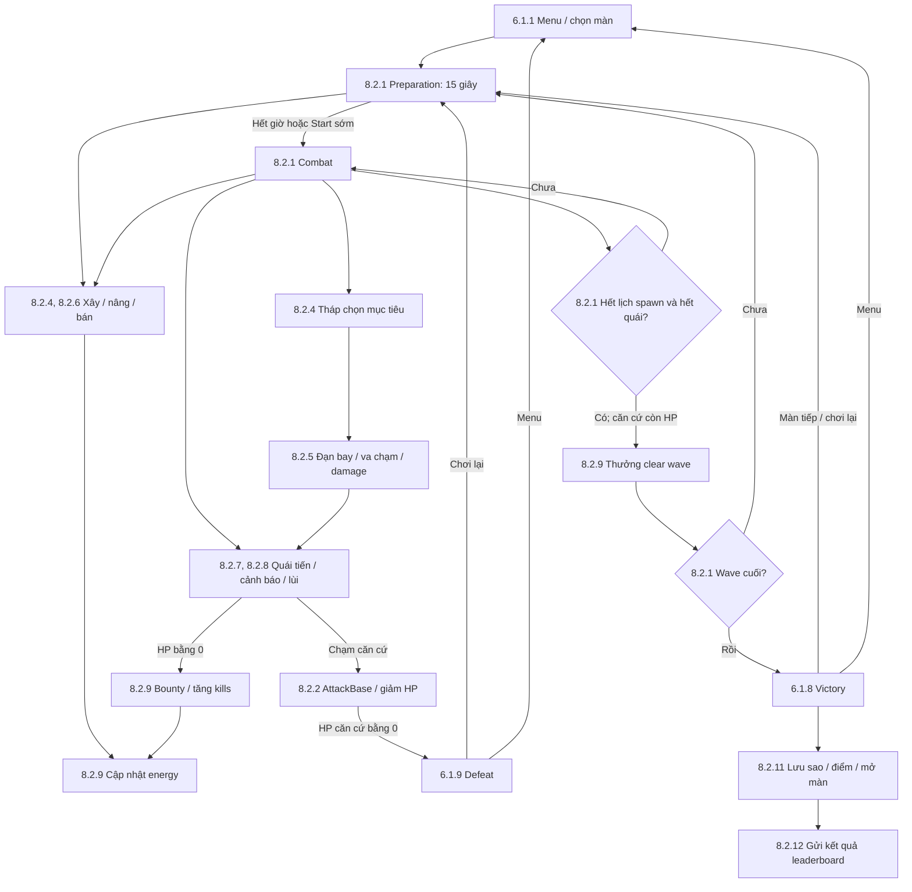

# GAME DESIGN DOCUMENT — DODGE LINE: MIST VALLEY

**Ngày cập nhật:** 11/11/2026. **Phạm vi:** cơ chế đang được hiện thực trong repo, chiến dịch một người chơi gồm năm màn.

Bố cục tham khảo tài liệu *Game-Design-Document-Template.pdf* do người dùng cung cấp. Các đề mục được giữ theo template và diễn giải phù hợp với game thủ thành. Thông số được đối chiếu với code, data asset và scene; hướng dẫn vận hành và báo cáo kiểm thử được dẫn riêng ở cuối tài liệu.

## 1. Game Name — Tên game

**Dodge Line — Mist Valley**.

Người chơi bảo vệ một tiền đồn bằng cách xây phòng thủ dọc đường tiến quân của quái. Điểm đặc trưng là Retreat Wisp có thể dự đoán nguy hiểm từ đạn đang bay và lùi tránh trên chính tuyến đường đó.

## 2. Genre — Thể loại

Thủ thành chiến thuật 2D thời gian thực, chia theo wave, với camera nhìn từ trên xuống. Người chơi quản lý vị trí phòng thủ, energy và thời điểm nâng cấp; các công trình tự chọn mục tiêu và chiến đấu.

## 3. Game Elements — Hoạt động chính

- Chọn ô xây để tận dụng tầm bắn và giữ hỏa lực gần căn cứ.
- Kết hợp Thorn Bow bắn đơn, Dust Cannon gây sát thương vùng và Wire Trap làm chậm.
- Quan sát loại quái, dấu cảnh báo của Wisp và tình trạng căn cứ để quyết định chi tiêu.
- Chọn giữa xây thêm, nâng cấp hoặc bán công trình để phân phối lại energy.
- Hoàn thành các màn, cải thiện số sao và cạnh tranh điểm tốt nhất trên leaderboard.

## 4. Player — Người chơi

**Một người điều khiển mỗi trận.** Người chơi đóng vai trò chỉ huy phòng thủ, không có nhân vật di chuyển trực tiếp trên bản đồ. HP của căn cứ là điều kiện sống còn của trận.

Các người chơi có thể so sánh kết quả qua leaderboard online. Combat vẫn được mô phỏng độc lập trên từng máy; không có co-op hoặc đồng bộ trận đấu giữa người chơi.

## 5. Technical Specs — Thông số kỹ thuật

| Đề mục trong template | Thiết kế hiện tại |
| --- | --- |
| Technical Form | Đồ họa 2D; sprite cho môi trường, căn cứ, quái và phòng thủ; hình đơn giản cho đạn và phản hồi chiến đấu |
| View | Camera trực giao, nhìn từ trên xuống, không có thao tác zoom/pan của người chơi |
| Platform | Windows PC và Web desktop; bản Web hiện dùng Chrome để chơi/trình bày |
| Language | C# cho gameplay; JavaScript cho tích hợp với trình duyệt |
| Device | Máy tính có chuột và bàn phím; chưa có điều khiển cảm ứng hoặc controller |
| Engine | Unity 6000.6.7f1, URP 2D, Input System, Physics2D và IMGUI |
| Network | Unity Gaming Services Authentication và Leaderboards qua HTTPS/JSON |

## 6. Game Play — Trải nghiệm chơi

Người chơi bắt đầu một màn với căn cứ 20 HP và 150 energy. Trong 15 giây chuẩn bị, người chơi đặt Bow vào các vòng vàng và đặt Trap lên ô đường hợp lệ. Khi wave bắt đầu, Runner lao về tiền đồn, Wisp có thể cảnh báo rồi lùi trước một đường đạn nguy hiểm, còn Iron Guard tiến chậm nhưng chịu đòn tốt nhờ HP và giáp. Người chơi dùng tiền tích lũy trong trận để bổ sung phòng thủ và nâng cấp các tháp đang hoạt động. Quái chạm căn cứ sẽ đứng lại đánh liên tục, buộc người chơi duy trì khả năng tiêu diệt ở tuyến cuối. Vượt qua mọi wave khi căn cứ còn HP sẽ hoàn thành màn, nhận sao và mở màn tiếp theo.

### 6.1. Game Play Outline — Trình tự chơi

#### 6.1.1. Opening the game application — Bắt đầu

Game mở ở menu chiến dịch, hiển thị năm màn cùng trạng thái mở khóa, sao và điểm cao nhất đã lưu. Màn 1 luôn có sẵn. Chọn một màn đã mở để bắt đầu trận mới tại màn đó.

#### 6.1.2. Game options — Lựa chọn

Menu cung cấp chọn màn, hướng dẫn chơi, leaderboard và thoát game. Trong trận có tạm dừng, tiếp tục, chơi lại và quay về menu. Bản hiện tại không có lựa chọn độ khó, cấu hình âm thanh hoặc chế độ chơi khác.

#### 6.1.3. Story synopsis — Bối cảnh

Mist Valley là một thung lũng rừng tối với các lối mòn dẫn tới tiền đồn. Người chơi phải giữ tuyến phòng thủ trước những đợt sinh vật tiến vào. Bối cảnh được thể hiện qua môi trường và các màn; chưa có hội thoại, cutscene hoặc cốt truyện phân nhánh.

#### 6.1.4. Modes — Chế độ

Một chiến dịch single-player gồm năm màn theo thứ tự. Màn đã hoàn thành có thể chơi lại để cải thiện sao và điểm. Leaderboard là tính năng so sánh kết quả của chiến dịch, không phải một chế độ combat riêng.

#### 6.1.5. Game elements — Thành phần trong trận

Một căn cứ, một hoặc hai tuyến đường định sẵn, các ô xây tháp, ba loại phòng thủ và ba loại quái. Energy được dùng chung cho mọi giao dịch trong màn. Đạn bay và va chạm thật quyết định sát thương; một lần Wisp bắt đầu né không đồng nghĩa đạn chắc chắn trượt.

#### 6.1.6. Game levels — Các màn chơi

| Màn | Bố cục | Wave | Ô xây tháp | Tổng quái | Trọng tâm chiến thuật |
| --- | --- | ---: | ---: | ---: | --- |
| 1 — Forest Road | Một đường thẳng | 6 | 5 | 68 | Làm quen Bow, Trap, nâng cấp và phòng thủ gần căn cứ |
| 2 — Twilight Crossing | Hai đường song song | 8 | 8 | 166 | Mở Dust Cannon, bố trí hỏa lực bao phủ hai tuyến |
| 3 — Ancient Garden | Một đường gấp khúc chữ S | 8 | 6 | 163 | Tận dụng khúc cua và thời gian quái đi trong tầm bắn |
| 4 — Amber Quarry | Hai đường ngoài rẽ vào trong | 9 | 8 | 232 | Phân phối hỏa lực giữa chặn sớm và giữ tuyến cuối |
| 5 — Moonlit Sanctuary | Hai đường zíc zắc có vị trí rẽ khác nhau | 10 | 7 | 301 | Kết hợp chia tuyến, sát thương vùng, slow và nâng cấp |

Toàn chiến dịch có **41 wave và 930 quái**. Các tuyến cùng dẫn đến một căn cứ; không tự hợp nhất hoặc đổi đường trong trận.

Ảnh bố cục: [màn 1](../DebugCaptures/Campaign_Level1.png), [màn 2](../DebugCaptures/Campaign_Level2.png), [màn 3](../DebugCaptures/Campaign_Level3.png), [màn 4](../DebugCaptures/Campaign_Level4.png), [màn 5](../DebugCaptures/Campaign_Level5.png).

#### 6.1.7. Player’s controls — Điều khiển

Chuột dùng để xây và chọn công trình; phím tắt dùng để đổi loại phòng thủ, nâng cấp, bán, bắt đầu wave và điều khiển phiên chơi. Bảng phím cụ thể nằm ở mục **8.5.2**.

#### 6.1.8. Winning — Chiến thắng

Hoàn thành wave cuối khi toàn bộ quái đã bị tiêu diệt và căn cứ còn ít nhất 1 HP. Nhận thưởng clear wave trước khi chốt điểm và sao. Thắng màn N mở màn N+1, tối đa màn 5.

#### 6.1.9. Losing — Thất bại

Căn cứ về 0 HP gây thất bại ngay. Một quái đang đánh căn cứ vẫn được tính là còn sống và ngăn kết thúc wave. Nếu mất căn cứ cùng thời điểm xử lý kết quả wave, thất bại được ưu tiên.

#### 6.1.10. End — Kết thúc

Sau kết quả, combat dừng. Người chơi có thể chơi lại hoặc về menu; khi thắng còn có thể xem leaderboard và sang màn tiếp theo nếu chưa phải màn 5. Hoàn thành màn 5 kết thúc chiến dịch. Không lưu trạng thái của một trận đang chơi dở.

#### 6.1.11. Why is all this fun? — Giá trị trải nghiệm

Số ô xây hữu hạn khiến người chơi phải chọn vị trí và loại tháp thay vì phủ kín bản đồ. Đạn có thời gian bay và Wisp có thể đổi hướng, tạo sự khác biệt giữa sát thương lý thuyết và hiệu quả thực tế. Slow giúp giữ quái trong vùng hỏa lực, Cannon xử lý cụm đông, còn việc ưu tiên quái đang đánh nhà tạo cơ hội cứu căn cứ ở thời điểm nguy hiểm. Sao và điểm cao khuyến khích chơi lại bằng chiến thuật tiết kiệm và giữ HP tốt hơn.

## 7. Key Features — Đặc điểm chính

- Wisp dùng FSM và dự đoán CPA để quyết định cảnh báo, lùi và tiếp tục tiến.
- Projectile di chuyển thật; Wisp vẫn có thể bị bắn trúng khi đang né.
- Bow và Cannon chia sẻ các ô xây cố định; nâng cấp và bán tạo lựa chọn về chi tiêu.
- Trap làm chậm nhưng không cản đường, không đổi tuyến và không làm chậm nhịp đánh căn cứ.
- Quái chạm căn cứ sẽ liên tục tấn công cho đến khi bị tiêu diệt.
- Năm màn với đường thẳng, nhiều tuyến và đường gấp khúc; độ khó tăng bằng thành phần wave và HP quái.
- Leaderboard từng màn, gửi điểm sau chiến thắng và giữ kết quả chờ gửi khi lỗi mạng.

## 8. Design Document — Thiết kế cơ chế

### 8.1. Design Guidelines — Nguyên tắc thiết kế

1. **Vị trí và chi tiêu là quyết định chính:** ô xây hữu hạn, energy có giới hạn và nâng cấp cần trả tiền.
2. **Phản ứng của quái có thể quan sát:** cảnh báo xuất hiện trước khi Wisp lùi; né không tạo miễn sát thương và không bảo đảm thành công.
3. **Đường đi có thể dự đoán:** quái giữ tuyến đã gán, giữ khoảng cách và chỉ đánh khi chạm căn cứ.
4. **Phản hồi rõ ràng:** HP, energy, vùng tác dụng, preview đặt hợp lệ và trạng thái trận được thể hiện trên màn hình.
5. **Nội dung trong phạm vi hiện tại:** một chiến dịch năm màn; chưa có boss Shadow Matriarch, co-op, âm thanh hoặc hoạt ảnh sprite đầy đủ. Không bổ sung các tính năng này chỉ để điền template.

Hình ảnh theo phong cách fantasy rừng tối, gỗ, đá, gai và ánh đèn vàng. Các phản hồi hiện có gồm dấu cảnh báo vàng, đổi màu khi lùi/nhận đòn, chớp bắn, vùng nổ và phản hồi căn cứ bị đánh. Cây, đá và phế tích trên nền hiện là trang trí, không mặc nhiên tạo vật cản gameplay.

### 8.2. Game Design Definitions — Định nghĩa cơ chế

#### 8.2.1. Trạng thái trận và vòng wave

| Trạng thái | Hành vi | Điều kiện chuyển |
| --- | --- | --- |
| Preparation | Đếm ngược 15 giây; được xây, nâng và bán; không có income theo thời gian | Hết giờ hoặc người chơi bắt đầu sớm |
| Combat | Spawn, di chuyển, bắn, né, slow, đánh căn cứ và income hoạt động; vẫn được giao dịch | Hết lịch spawn và không còn quái, hoặc căn cứ bị phá |
| Victory | Dừng combat, lưu kết quả, mở màn và gửi điểm | Chọn màn tiếp, chơi lại hoặc menu |
| Defeat | Dừng combat; không gửi điểm trận thua | Chơi lại hoặc menu |

Pause dừng mô phỏng và giao dịch; không đổi Preparation/Combat thành một loại trận khác. Thời gian chờ request mạng không phụ thuộc pause.

Giữa các wave cùng màn, HP căn cứ, energy, tháp, cấp nâng và lượt Trap còn lại được giữ. Đạn còn lại được xóa khi clear wave. Đổi màn hoặc Retry tạo trận mới với 20 HP, 150 energy và không có phòng thủ đã xây từ trận trước.

#### 8.2.2. Căn cứ và AttackBase

Mỗi màn có một căn cứ 20 HP ở cuối tuyến, không tự hồi HP hoặc bắn trả. Hitbox căn cứ là hình chữ nhật 1.6 × 3.6 units; quái phải tiếp xúc với hitbox này mới vào **AttackBase**.

Gần cuối đường, quái chọn một trong sáu điểm tiếp xúc ở mép căn cứ, ưu tiên các điểm ngoài trước. Với hai tuyến, tuyến trên sử dụng ba điểm phía trên và tuyến dưới sử dụng ba điểm phía dưới. Quái giữ điểm đã đặt chỗ cho tới khi chết hoặc trận reset, kể cả khi đang lùi khỏi đoạn tiếp cận. Khi hết điểm trống, quái dư chờ trên đường và vẫn được tính là còn sống.

AttackBase dừng chuyển động. Quái chờ đủ thời gian đánh lần đầu rồi gây damage lặp lại theo chu kỳ của loại quái. Không đánh từ xa khi đang chờ chỗ. Wisp đã vào AttackBase không bắt đầu né nữa. Nếu mất tiếp xúc với căn cứ, quái quay về Advance để tiếp cận lại.

#### 8.2.3. Đi theo đường và giữ khoảng cách

Quái di chuyển theo danh sách waypoint của tuyến được gán lúc spawn, từ trái sang căn cứ. Tại khúc cua, quái đi theo từng đoạn đường; khi lùi cũng đi ngược trên route đó, không cắt đường chéo. Không có A*, tìm đường vòng hoặc chọn lại tuyến.

Mỗi quái có hitbox tròn bán kính **0.25 unit**. Khoảng cách tâm tối thiểu giữa hai quái được tính bằng:

```text
Khoảng cách tâm tối thiểu = bán kính A + bán kính B + đệm an toàn
Đệm an toàn = 0.05 unit
Với hitbox hiện tại: 0.25 + 0.25 + 0.05 = 0.55 unit
```

Trên đường chung của một tuyến, quái sau giảm tiến độ hoặc dừng khi không còn đủ khoảng cách, không đi xuyên qua quái trước. Việc di chuyển cũng xét clearance trong không gian thực khi các đoạn đường hoặc đoạn tiếp cận nằm gần nhau. Điểm spawn bị chiếm sẽ hoãn quái tiếp theo, không chèn quái vào vị trí đang có quái khác.

Khoảng lùi khả dụng là quãng đường còn được phép di chuyển sau khi trừ hitbox và đệm, không phải khoảng cách tâm. Trên đoạn thẳng, nếu quái phía sau cách tâm D và không có giới hạn khác:

```text
Khoảng lùi do quái sau giới hạn = max(0, D − 0.25 − 0.25 − 0.05)
```

D = 0.85 cho 0.30 unit lùi khả dụng; D = 0.55 cho 0 unit. Vị trí spawn, các quái khác và góc cua có thể làm khoảng lùi thực tế ngắn hơn.

#### 8.2.4. Tháp, đặt tháp và nâng cấp

**Bow và Cannon chỉ được đặt vào các vòng vàng được chỉ định trên map.** Click trong vòng, kể cả tại biên bán kính 0.47 unit, sẽ snap tháp và preview về tâm ô. Đất trống ngoài mọi vòng không phải vị trí xây hợp lệ.

Mỗi ô chứa một tháp, dùng chung cho hai loại vũ khí. Nâng cấp giữ nguyên ô; bán giải phóng ô. Tháp không được chồng đường, căn cứ, đoạn tiếp cận, công trình khác hoặc vượt terrain. Footprint Bow có bán kính 0.35, Cannon 0.45; tầm bắn không phải footprint. Ô xây không có chức năng chặn quái hoặc đạn.

| Tháp | Mở từ màn | Giá xây | Damage cấp 1 / 2 / 3 | Tầm bắn cấp 1 / 2 / 3 | Chu kỳ bắn | Giá lên cấp 2 / 3 |
| --- | ---: | ---: | --- | --- | --- | --- |
| Thorn Bow | 1 | 50 | 12 / 17 / 23 | 4.0 / 4.3 / 4.6 | 0.8 giây | 35 / 45 |
| Dust Cannon | 2 | 90 | 22 / 30 / 40 | 5.0 / 5.2 / 5.5 | 1.6 giây | 65 / 85 |

Tháp mới luôn ở cấp 1, tối đa cấp 3. Chỉ damage và range tăng khi nâng cấp; tốc độ bắn, tốc độ đạn, thời gian sống và bán kính nổ không tăng. Vũ khí **không tự scale theo màn hoặc wave**.

Mỗi lần sẵn sàng bắn, tháp chọn lại một quái còn sống có tâm trong tầm theo thứ tự:

1. Ưu tiên quái đang AttackBase.
2. Trong cùng nhóm, chọn quái có quãng đường còn lại tới điểm đánh căn cứ ngắn hơn.
3. Nếu vẫn bằng nhau, chọn ID nhỏ hơn.

Tháp không ghim cố định một mục tiêu giữa các phát. Quái Alert hoặc Evade vẫn được chọn. Hướng bắn đón được ước lượng hai lần từ vị trí, vận tốc hiện tại của quái và tốc độ đạn; thuật toán không biết trước lần đổi trạng thái hoặc góc cua sắp tới.

#### 8.2.5. Projectile và sát thương

| Thuộc tính | Đạn Thorn Bow | Đạn Dust Cannon |
| --- | ---: | ---: |
| Tốc độ | 6 units/giây | 5 units/giây |
| Bán kính va chạm | 0.08 | 0.12 |
| Thời gian sống tối đa | 3 giây | 3 giây |
| Vùng nổ | Không | Bán kính 1.2 units |

Đạn bay theo hướng đã bắn, không tự lái hoặc bám mục tiêu. Physics2D kiểm tra va chạm và quét quãng đường di chuyển để tránh xuyên qua quái. CPA chỉ phục vụ dự đoán né, không quyết định đòn đánh đã trúng.

- Đạn Bow gây damage cho quái đầu tiên va chạm rồi biến mất; có thể trúng quái khác với mục tiêu ban đầu.
- Đạn Cannon nổ khi chạm quái đầu tiên hoặc tới điểm ngắm đã chốt lúc bắn. Mọi hitbox quái giao với vùng nổ nhận đủ damage, mỗi quái một lần, không giảm theo khoảng cách và không giới hạn cùng tuyến.
- Đạn hết thời gian sống hoặc bị vật cản chặn đạn hấp thụ sẽ bị hủy; trường hợp này không tự tạo vụ nổ. Các map hiện tại không có vật cản đạn gameplay ở giữa map.
- Tháp, Trap và căn cứ không hấp thụ đạn. Hiệu ứng chớp/nổ chỉ phản hồi hình ảnh, không gây thêm một lần damage.

```text
Damage thực nhận = max(1, damage của phát bắn − armor của quái)
```

Bow cấp 1 gây 8 damage lên Iron Guard; Cannon cấp 1 gây 18. Không có chí mạng hoặc xác suất trúng được tính sẵn. Wisp đổi hướng có thể làm đạn trượt, nhưng vẫn nhận sát thương bình thường nếu va chạm.

#### 8.2.6. Wire Trap

| Thuộc tính | Giá trị |
| --- | --- |
| Giá đặt | 35 energy |
| Footprint logic | Bán kính 0.25 unit |
| Vùng kích hoạt | Bán kính 0.8 unit |
| Slow | Giảm 50% tốc độ di chuyển trong 2 giây |
| Lượt sử dụng | 6 quái khác nhau |
| Nâng cấp / sát thương | Không có |

Trap chỉ đặt trên ô đường hợp lệ, snap theo lưới cách 1 unit dọc dải đường thẳng. Waypoint thẳng hàng không ngắt dải. Ô đầu cách spawn hoặc đầu dải sau góc ít nhất 1 unit; trước góc thật chừa ít nhất 0.6 unit. Đoạn quá ngắn có thể không có ô. Không đặt trùng Trap, chồng căn cứ hoặc footprint của các điểm tiếp xúc căn cứ, kể cả điểm đang trống.

Được đặt dưới quái đang di chuyển, Alert hoặc Evade và tại ô đường hợp lệ gần căn cứ; không có thời gian lắp đặt. Trap không chiếm ô xây tháp, không có collider solid, không chặn chuyển động và không làm quái đổi đường.

Khi quái sống overlap vùng kích hoạt trong Combat, Trap chỉ tác dụng nếu quái cùng tuyến và cùng dải đường thẳng tương đương. Một quái chỉ tốn một lượt trên cùng Trap, kể cả khi lùi qua lần nữa. Trap khác có thể làm mới timer slow về 2 giây; hiệu ứng không nhân chồng. Rời vùng Trap không xóa slow ngay.

Quái thứ sáu vẫn nhận slow rồi Trap bị tiêu hao và biến mất. Có thể bán Trap còn lượt. Quái AttackBase bị bỏ qua, không làm mất lượt và không bị chậm nhịp đánh nhà. Slow đã nhận trước đó cũng chỉ ảnh hưởng di chuyển, không thay đổi thời gian đánh căn cứ.

#### 8.2.7. Các loại quái và độ khó

| Quái | HP gốc | Tốc độ | Giáp | Energy khi diệt | Damage căn cứ | Chờ đánh lần đầu | Chu kỳ đánh |
| --- | ---: | ---: | ---: | ---: | ---: | --- | --- |
| Runner | 40 | 1.6 | 0 | 6 | 1 | 1.0 giây | 2.0 giây |
| Retreat Wisp | 55 | 1.3 | 0 | 10 | 1 | 1.0 giây | 2.0 giây |
| Iron Guard | 160 | 0.8 | 4 | 20 | 2 | 1.5 giây | 3.0 giây |

Runner tạo áp lực bằng tốc độ và số lượng. Wisp có thêm khả năng cảnh báo/lùi. Iron Guard chịu đòn lâu hơn nhờ HP và giáp, nhưng tiến chậm.

Trong lịch wave hiện tại, Runner có từ wave 1 màn 1, Wisp từ wave 3 màn 1 và Iron Guard từ wave 4 màn 1. Đây là thời điểm xuất hiện của quái; điều kiện mở Dust Cannon vẫn là màn 2.

**Chỉ HP tự scale khi spawn:**

```text
HP spawn = HP gốc × [1 + 0.08 × (số wave − 1)] × hệ số màn
```

Hệ số của màn 1–5 lần lượt là **1.00 / 1.10 / 1.15 / 1.20 / 1.25**. Phần tăng theo wave là tuyến tính, không phải lũy thừa 1.08. Ví dụ Wisp ở wave 3 màn 2 có 55 × 1.16 × 1.10 = 70.18 HP. Tốc độ, giáp, bounty, damage căn cứ và số lượt né không tự tăng theo màn/wave.

#### 8.2.8. AI của Retreat Wisp

| Trạng thái | Hành vi |
| --- | --- |
| Advance | Tiến về căn cứ; phát hiện nguy hiểm khi còn lượt né và hết hồi chiêu |
| Alert | Hiện cảnh báo vàng trong 0.20 giây; vẫn tiến nếu đường còn trống |
| Evade | Lùi trên chính route đã đi, vẫn có thể bị đạn hoặc vụ nổ gây sát thương |
| AttackBase | Dừng và đánh căn cứ; không mở lần né mới |
| Dead | Dừng hoạt động, trả thưởng một lần và giải phóng chỗ tại căn cứ |

Runner và Iron Guard dùng phần Advance/AttackBase/Dead của cơ chế này. Không có học máy hoặc tỷ lệ né ngẫu nhiên.

**Nhận biết nguy hiểm bằng CPA:** mỗi 0.1 giây, Wisp đủ điều kiện xét các projectile đang hoạt động. CPA là thời điểm dự đoán hai vật thể đến gần nhau nhất, dựa trên vận tốc tương đối hiện tại.

```text
d = vị trí đạn − vị trí Wisp
u = vận tốc đạn − vận tốc Wisp
H = min(1.2 giây, thời gian sống còn lại của đạn)

Nếu |u|² > 0.000001:
    tCPA = clamp(−dot(d, u) / |u|², 0, H)
Nếu gần bằng 0:
    tCPA = 0

Nguy hiểm nếu |d + u × tCPA| ≤ bán kính Wisp + bán kính đạn + 0.05
```

Biên CPA 0.05 là thông số riêng với đệm giữ khoảng cách giữa quái. Không có bán kính cảm biến riêng ngoài phép dự đoán này. Trong các đạn nguy hiểm, chọn đạn có tCPA sớm nhất; nếu bằng nhau dùng ID nhỏ hơn. Một cặp Wisp–đạn chỉ tạo Alert một lần. Trap và vùng nổ tương lai không được xét như projectile đang bay.

**Quyết định sau cảnh báo:** kiểm tra lại đạn đã theo dõi và khoảng lùi. Nếu đạn còn nguy hiểm và có ít nhất **0.30 unit lùi khả dụng sau khi giữ clearance**, Wisp bắt đầu Evade. Nếu không, quay về Advance mà không tốn lượt hoặc hồi chiêu. Alert đang tiến mà chạm căn cứ có thể chuyển sang AttackBase.

| Thuộc tính né | Giá trị |
| --- | --- |
| Số lần bắt đầu Evade | Tối đa 2 lần trong đời quái |
| Khoảng lùi tối đa mỗi lần | 1.5 units |
| Hệ số tốc độ lùi | 1.2 × tốc độ tiến |
| Tốc độ lùi bình thường / đang slow | 1.56 / 0.78 units/giây |
| Hồi chiêu | 4 giây, bắt đầu khi vào Evade |

Lượt né bị trừ khi bắt đầu Evade. Khoảng trống được kiểm tra lại trong lúc lùi; gặp quái khác hoặc tới giới hạn thì dừng lùi và trở lại Advance, không hoàn lượt. Có thể lùi qua góc hoặc trên đoạn tiếp cận đã đi, không lùi vượt điểm spawn. Trạng thái né không hủy projectile và không làm Wisp mất quyền bị tháp chọn.

#### 8.2.9. Energy và giao dịch

| Nguồn hoặc giao dịch | Quy tắc |
| --- | --- |
| Energy đầu màn / Retry | 150 |
| Income thời gian | 2 energy/giây trong Combat; giữ phần lẻ khi tích lũy |
| Bắt đầu wave sớm | +5, một lần mỗi wave nếu timer còn lớn hơn 0 |
| Diệt quái | Runner +6, Wisp +10, Guard +20 |
| Clear wave N | +20 + 5 × N, kể cả wave cuối |
| Xây / nâng cấp | Trừ đúng chi phí khi giao dịch thành công |
| Bán | Hoàn floor(70% tổng energy đã trả cho công trình) |

Đặt sai, hủy đặt và nâng cấp thất bại không mất tiền. Không có income thời gian trong Preparation, pause hoặc sau kết quả. Không có khoản thưởng khi quái chỉ chạm căn cứ.

Bow cấp 3 đã chi 130 energy, bán nhận 91; Cannon cấp 3 đã chi 240, bán nhận 168. Trap bán nhận 24 energy, không phụ thuộc số lượt còn lại miễn là chưa tiêu hao hết.

#### 8.2.10. Thành phần và nhịp wave

Các wave được soạn sẵn, không random loại quái hoặc tuyến spawn trong trận. Mỗi entry có loại quái, độ trễ tính từ lần spawn thực tế trước và tuyến được gán. Nếu spawn bị chiếm, lịch đợi thêm và giữ độ trễ cho những quái sau, không dồn chúng vào cùng lúc.

Mỗi ô dưới đây là **Runner / Wisp / Guard**; dấu — nghĩa là màn không có wave đó.

| Wave | Màn 1 | Màn 2 | Màn 3 | Màn 4 | Màn 5 |
| --- | --- | --- | --- | --- | --- |
| 1 | 6/0/0 | 8/3/1 | 8/2/1 | 10/3/2 | 8/2/1 |
| 2 | 8/0/0 | 10/4/2 | 10/2/1 | 12/3/2 | 12/4/2 |
| 3 | 8/2/0 | 10/6/2 | 12/3/1 | 14/4/2 | 16/5/3 |
| 4 | 8/4/1 | 12/6/3 | 14/3/2 | 16/4/3 | 18/5/4 |
| 5 | 10/4/2 | 10/8/4 | 16/4/2 | 18/5/3 | 20/6/4 |
| 6 | 8/5/2 | 12/8/4 | 18/4/2 | 20/5/3 | 22/6/4 |
| 7 | — | 14/8/5 | 20/5/3 | 22/6/4 | 24/7/5 |
| 8 | — | 12/9/5 | 22/5/3 | 24/6/4 | 26/7/5 |
| 9 | — | — | — | 26/7/4 | 28/8/5 |
| 10 | — | — | — | — | 30/8/6 |

Nhịp spawn theo thứ tự **Wisp → Guard → Runner**, bỏ qua nhóm không có:

- Wisp cách nhau 3 giây ở màn một tuyến, hoặc 1.5 giây khi luân phiên hai tuyến.
- Guard đầu xuất hiện sau Wisp cuối 6 giây; các Guard tiếp theo cách 2 giây.
- Runner đầu xuất hiện sau Guard cuối 2 giây, hoặc sau Wisp cuối 6 giây nếu không có Guard.
- Các Runner tiếp theo cách 0.9 giây ở một tuyến, hoặc 0.32 giây khi luân phiên hai tuyến.
- Entry đầu của wave có delay 0. Tuyến khởi đầu được luân phiên theo wave ở màn hai tuyến; hai tuyến vẫn dùng chung lịch spawn tuần tự.

Cho Wisp đi trước và chừa khoảng nghỉ trước nhóm sau giúp tạo cơ hội lùi, thay vì xếp Runner nhanh hơn ngay sát phía sau. Đây không phải bảo đảm luôn né được: slow, quái dồn hàng và trạng thái combat có thể làm mất khoảng trống.

#### 8.2.11. Điểm, sao và tiến trình

```text
Điểm hoàn thành màn = 100 × HP căn cứ còn lại + energy còn lại + 10 × số quái đã diệt
```

Điểm được chốt sau thưởng clear wave cuối. Thời gian combat được ghi kèm kết quả mạng, không nằm trong công thức điểm.

| HP khi thắng | Sao |
| --- | ---: |
| 18–20 | 3 |
| 10–17 | 2 |
| 1–9 | 1 |

Lưu cục bộ mức màn đã mở, số sao tốt nhất và điểm cao nhất của từng màn. Sao và điểm được giữ tốt nhất độc lập; kết quả kém hơn không ghi giảm chúng. Không cần đạt số sao nhất định để mở màn sau, chỉ cần thắng màn trước. Không mang energy, tháp, cấp nâng hoặc HP sang màn mới.

Windows và từng trình duyệt/origin có vùng lưu riêng. Không có cloud save mở màn hoặc cơ chế tiếp tục trận đang dở; xóa dữ liệu local có thể làm mất tiến trình trên thiết bị đó.

#### 8.2.12. Leaderboard — Module network

Mỗi màn dùng một bảng điểm riêng. Quy tắc cấu hình bảng trên dịch vụ là **điểm giảm dần và Keep Best**; client gửi điểm tuyệt đối. Client đăng nhập ẩn danh khi cần truy cập mạng. Người chơi có thể lưu tên hiển thị 2–18 ký tự gồm chữ, số, khoảng trắng, `_` và `-`; tên giống nhau không gộp hai danh tính.

Sau Victory, game lưu tiến trình local và kết quả chờ gửi rồi gửi điểm tuyệt đối lên server, kèm tên, HP, số quái đã diệt, thời gian combat và phiên bản luật. Defeat không gửi điểm. Bảng hiển thị Top 10 cùng điểm/hạng cá nhân, kể cả khi người chơi ngoài Top 10.

Nếu lỗi mạng, kết quả vẫn nằm trong hàng đợi, tối đa một kết quả tốt nhất đang chờ cho mỗi màn. Có thể thử lại khi thắng tiếp hoặc mở bảng/bấm Refresh / send pending. Gửi lại không cộng dồn điểm; kết quả mới tốt hơn không bị xóa bởi xác nhận của lần gửi cũ. Chuyển màn và Retry không phải đợi request mạng hoàn tất.

Leaderboard không đồng bộ combat, không khôi phục save tiến trình và không liên kết danh tính Windows với Web chỉ bằng tên hiển thị. Bản hiện tại dùng bộ luật bảng v2. Server chưa chạy lại trận để xác minh điểm hoặc chống sửa client; đây chưa phải hệ thống thi đấu có chống gian lận.

### 8.3. Game Flowchart — Sơ đồ tương tác

Các số trong nút tham chiếu đến mục mô tả cơ chế tương ứng.



Chơi lại tạo Preparation mới của màn hiện tại; chọn Next stage tạo Preparation của màn kế nếu đã mở. Gửi leaderboard là công việc nền, không bắt người chơi chờ trước khi chuyển màn.

### 8.4. Player Definition — Định nghĩa người chơi

#### 8.4.1. Player Definitions — Vai trò và hành động

Người chơi là chỉ huy nhìn toàn bản đồ, điều khiển gián tiếp thông qua công trình. Có thể đặt, chọn, nâng cấp và bán phòng thủ; quyết định bắt đầu wave sớm; tạm dừng, chơi lại và chọn màn đã mở. Không trực tiếp chọn mục tiêu từng phát hoặc điều khiển đường bay của đạn.

Không có thuộc tính HP của avatar, túi đồ hoặc vật phẩm tiêu hao riêng. Căn cứ, energy và mạng lưới phòng thủ là các tài sản quyết định trận đấu.

#### 8.4.2. Player Properties — Thuộc tính và phản hồi

| Thuộc tính | Thay đổi bởi | Phản hồi cho người chơi |
| --- | --- | --- |
| HP căn cứ | Đòn đánh sau tiếp xúc của quái | Số HP trên HUD, căn cứ chớp khi nhận đòn, màn Defeat khi về 0 |
| Energy | Income, bounty, thưởng wave, xây/nâng/bán | Số dư HUD và trạng thái đủ/thiếu tiền của giao dịch |
| Phòng thủ đã xây | Đặt mới, bán, Trap hết lượt | Công trình xuất hiện/biến mất; vòng tầm bắn hoặc vùng slow khi chọn |
| Cấp tháp | Trả phí nâng cấp | Nhãn cấp, thông số damage/range và dấu cấp trên tháp |
| Lượt Trap | Quái hợp lệ kích hoạt lần đầu trên Trap đó | Số lượt còn lại khi chọn; Trap biến mất khi hết lượt |
| Tiến độ trận | Timer, spawn và tiêu diệt quái | Wave/phase/timer/số quái còn sống trên HUD |
| Sao, điểm tốt nhất, màn mở | Kết quả chiến thắng | Màn kết quả và thông tin trên menu chọn màn |
| Danh tính/điểm online | Đăng nhập ẩn danh, tên hiển thị và kết quả gửi | Top 10, hạng cá nhân, thông báo gửi/thử lại trên bảng online |

#### 8.4.3. Player Rewards — Phần thưởng

| Phần thưởng | Điều kiện | Công dụng |
| --- | --- | --- |
| Energy theo thời gian | Combat đang chạy | Tăng ngân sách để ứng phó trong wave |
| Bounty | Tiêu diệt quái | Tái đầu tư vào phòng thủ |
| Thưởng clear wave | Hết quái và lịch spawn của wave | Chuẩn bị cho wave tiếp hoặc cộng vào điểm cuối |
| Bonus Start sớm | Bắt đầu trước khi timer hết | Đổi thời gian chuẩn bị lấy thêm 5 energy |
| Sao và điểm tốt nhất | Hoàn thành màn | Ghi nhận hiệu quả giữ HP và quản lý tài nguyên |
| Mở màn tiếp theo | Thắng màn trước | Tiếp cận bố cục và thử thách mới |

Không có power-up nhặt trên map, hồi máu căn cứ hoặc loot ngẫu nhiên. Nâng cấp tháp là giao dịch do người chơi trả tiền, không phải phần thưởng tự động theo màn.

### 8.5. User Interface (UI) — Giao diện và điều khiển

#### 8.5.1. Bố cục và thông tin

Menu chính hiển thị năm màn, khóa/mở, sao/điểm tốt nhất, hướng dẫn, leaderboard và thoát. HUD trận được tổ chức theo khung 1280 × 720 rồi scale theo cửa sổ:

- **Thanh trên:** tên màn, HP căn cứ, energy, wave, phase, số quái, điểm, mô tả wave và nút xây/Start/Pause.
- **Vùng giữa:** bản đồ, tuyến đường, vòng ô xây, công trình, quái, đạn, HP quái và dấu cảnh báo.
- **Thanh dưới:** lựa chọn hiện tại, phản hồi giao dịch, thông số phòng thủ và nút Upgrade/Sell.
- **Overlay:** pause, Victory/Defeat và lựa chọn tiếp tục phiên chơi.

Preview đặt hợp lệ màu xanh, không hợp lệ màu đỏ và có lý do từ chối. Chọn tháp hiện vòng range; chọn Trap hiện vùng tác dụng. Lệnh đặt công trình dùng vùng map giữa hai thanh HUD. Khi mở leaderboard, thao tác với map bị khóa để người chơi tương tác với bảng.

#### 8.5.2. Bảng điều khiển

| Điều khiển | Hành động |
| --- | --- |
| `1` | Chọn Thorn Bow |
| `2` | Chọn Dust Cannon; chỉ xây được từ màn 2 |
| `3` | Chọn Wire Trap |
| Chuột trái trên map | Đặt phòng thủ đang chọn; khi không ở chế độ xây, chọn công trình để xem |
| Chuột phải | Hủy chế độ đặt và bỏ chọn phòng thủ |
| Click đất trống khi không xây | Bỏ chọn công trình |
| `U` | Nâng cấp tháp đang chọn nếu đủ tiền và chưa cấp 3 |
| `X` | Bán phòng thủ đang chọn |
| `Space` | Bắt đầu wave trong Preparation |
| `P` | Pause/resume trận chưa kết thúc |
| `Esc` | Hủy chế độ đặt; nếu không đang đặt thì pause/resume |
| `R` | Chơi lại màn hiện tại |

Các nút tương ứng trên HUD cung cấp cùng hành động. Khi pause không được đặt, nâng hoặc bán; khi kết thúc chỉ còn các lựa chọn kết quả. Không có điều khiển di chuyển nhân vật, xoay camera hoặc ngắm bắn thủ công.

## Tài liệu tham chiếu và nguồn đối chiếu

| Nhóm cơ chế | Nguồn trong repo |
| --- | --- |
| Vòng trận, energy, điểm, tiến trình | `GameManager.cs`, `ResourceManager.cs`, `CampaignStage.cs` |
| Tháp, placement và projectile | `TowerBuildPad.cs`, `PlacementSystem.cs`, `TowerWeapon.cs`, `Projectile.cs`, `WeaponData.cs` |
| Trap, tuyến đường và căn cứ | `WireTrap.cs`, `EnemyPath.cs`, `BaseController.cs` |
| Enemy và AI | `EnemyController.cs`, `EnemyData.cs`, `ThreatPrediction.cs`, `WaveSpawner.cs` |
| Giá trị và nội dung thực tế của năm màn | `Assets/Data/Enemies/`, `Assets/Data/Weapons/`, `Assets/Data/Levels/`, `Assets/Scenes/Levels/` |
| UI và network | `CampaignMenu.cs`, `CampaignHUD.cs`, `Assets/Scripts/DodgeLine/Network/` |

Các script gameplay trong bảng nằm dưới `Assets/Scripts/DodgeLine/`. Mô tả cơ chế không thay thế bằng chứng chạy thử hoặc kết luận cân bằng cuối cùng.

- [Hướng dẫn chơi, mở và chỉnh project](SOLO_GAME_GUIDE.md).
- [Cấu hình leaderboard và triển khai](NETWORK_AND_DEPLOYMENT.md).
- [Nguồn đồ họa](ART_PROVENANCE.md).
- [Báo cáo kiểm thử và các giới hạn đã ghi nhận](../TEST_REPORT.md).
