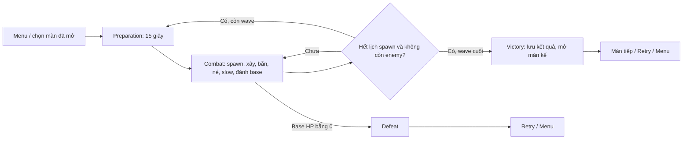
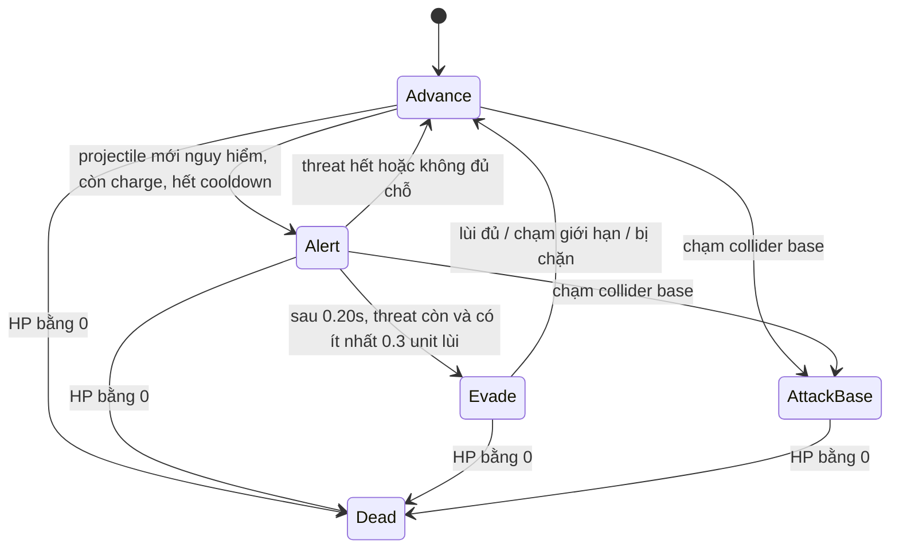
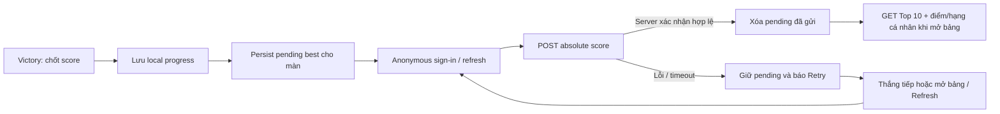

# GAME DESIGN DOCUMENT — DODGE LINE

**Bản mô tả game đang được triển khai — cập nhật 2026-11-10, bộ luật ô xây v2.**

Tài liệu này phản ánh code runtime, scene và data asset hiện tại của chiến dịch solo. Các thông số được đối chiếu với asset bằng Unity; hành vi được đối chiếu với script và test. Đây là thiết kế của bản đang chơi được, không phải danh sách tính năng đã hứa nhưng chưa làm. Cách mở, chỉnh và build project nằm ở [SOLO_GAME_GUIDE.md](SOLO_GAME_GUIDE.md); bằng chứng kiểm thử nằm ở [TEST_REPORT.md](../TEST_REPORT.md).

## 1. Tổng quan

**Thể loại:** tactical tower defense 2D, camera cố định nhìn từ trên xuống, điều khiển chuột và bàn phím, có đầu ra Windows PC và Web desktop.

**Ý tưởng chính:** bảo vệ một tiền đồn trong Mist Valley bằng Thorn Bow, Dust Cannon và Wire Trap. Enemy đi theo đường định sẵn. Retreat Wisp dự đoán va chạm của đạn đang bay, cảnh báo rồi có thể lùi trên chính tuyến đã đi. Enemy tới căn cứ không biến mất: chúng dừng tại mép căn cứ và tiếp tục đánh cho tới khi bị tiêu diệt.

**Trải nghiệm cần tạo:** người chơi vừa chặn lính giữa đường, vừa giữ hỏa lực ở tuyến cuối. Tốc độ projectile và chuyển động thật quyết định hit/miss; cảnh báo né không tạo miễn sát thương. Vị trí đặt tháp, cụm enemy, slow và thời điểm nâng cấp cùng ảnh hưởng kết quả.

**Nội dung hiện có:** một người chơi, năm màn, một căn cứ mỗi màn, ba loại enemy, hai loại tháp nâng tới cấp 3 và một loại trap. Có menu, hướng dẫn, chọn/mở khóa màn, pause, retry, kết quả, sao và điểm cao lưu cục bộ. Module network là leaderboard HTTPS: đăng nhập ẩn danh, gửi best score, Top 10/hạng cá nhân, hàng đợi điểm và retry. Các bảng Unity Cloud cần được tạo theo mục 14 trước khi sử dụng dịch vụ thật.

**Ngoài bản hiện tại:** Shadow Matriarch hoặc boss khác; âm thanh; sprite animation đi/bắn/chết đầy đủ; controller/touch; cloud save tiến trình; menu cài đặt và hệ thống tutorial theo từng wave. Thiết kế chỉ có một người điều khiển mỗi trận; các người chơi cạnh tranh gián tiếp qua bảng điểm.

## 2. Vòng chơi, điều khiển và màn hình

### 2.1 Vòng chơi



Mỗi màn bắt đầu ở Preparation, wave 1, HP 20 và energy 150. Preparation tự hết sau 15 giây hoặc người chơi nhấn Space sớm. Trong Combat có thể xây, nâng và bán phòng thủ. Wave chỉ kết thúc khi mọi entry đã spawn **và** mọi enemy đã chết; một enemy đang đánh base vẫn ngăn clear wave.

Giữa các wave cùng màn: giữ HP, tiền, tháp, cấp nâng, Trap và lượt còn lại. Nhận thưởng clear rồi sang Preparation tiếp; projectile còn lại được xóa. Sang màn mới hoặc Retry: tạo lại toàn bộ trận từ đầu. Defeat do base hết HP được ưu tiên trước kết quả clear; sau kết quả dừng spawn, income và combat.

### 2.2 Điều khiển đang có

| Input | Hành vi |
| --- | --- |
| 1 / 2 / 3 | Chọn Thorn Bow / Dust Cannon / Wire Trap; Cannon chỉ xây từ màn 2 |
| Click trái trên map | Đặt phòng thủ đang chọn; khi không ở chế độ đặt thì chọn tháp/Trap để xem |
| Click phải | Hủy đặt hoặc bỏ chọn, không mất tiền |
| Esc | Hủy chế độ đặt; khi không đang đặt thì pause/resume |
| U | Nâng tháp được chọn, tối đa cấp 3; cần đủ tiền |
| X | Bán phòng thủ được chọn; Trap không có nâng cấp |
| Space | Bắt đầu wave trong Preparation; +5 nếu bắt đầu trước khi timer hết |
| P | Pause/resume trận solo |
| R | Retry màn hiện tại |
| Nút HUD/kết quả | Chọn xây, Start, Pause/Resume, Upgrade, Sell, Retry, Next stage hoặc Campaign menu |

Pause dừng thời gian mô phỏng, chuyển động, projectile, slow/cooldown và income; không cho giao dịch khi pause. Mở menu, load màn và Retry đưa time scale về1. Không còn phím chuyển hai màn thử nghiệm F1/F2.

### 2.3 UI hiện tại

Main menu có năm nút màn, trạng thái khóa, sao/điểm cao nhất, How to play và Quit. Màn sau mở khi thắng màn trước. Quit tác dụng trên bản standalone; trong Editor dừng Play bằng nút Play của Unity.

Menu và kết quả Victory có nút **Online leaderboard**. Bảng dùng overlay nền kín riêng, chọn1..5 để xem Top 10 và hạng cá nhân, đổi tên hiển thị cục bộ và Refresh/send pending. Khi overlay mở, ẩn menu/HUD phía sau và khóa input đặt công trình. Không mở bảng trong combat qua phím tắt; không cần pause trận đang chơi để tải bảng.

HUD dùng IMGUI, thiết kế theo khung 1280×720 rồi scale theo kích thước cửa sổ. Thanh trên hiển thị tên màn, base HP, energy, wave, phase, số enemy sống, điểm, mô tả wave trong Preparation và nút xây/Start/Pause. Thanh dưới hiển thị lựa chọn, phản hồi đặt sai, thông số phòng thủ, Upgrade/Sell. Overlay dành cho pause và kết quả. Không dùng HUD chẩn đoán graybox làm giao diện chính.

Preview màu xanh/đỏ, vòng tầm bắn/slow và thông báo lý do từ chối. Trap snap vào ô đường; tháp chỉ snap vào tâm vòng vàng TowerBuildPad. Nút xây bị vô hiệu khi không đủ tiền hoặc chưa mở; chọn bằng phím vẫn có thể hiện preview không hợp lệ. Input chuột chỉ nhận vùng map giữa hai thanh HUD.

## 3. Kinh tế, điểm và tiến trình

| Quy tắc | Giá trị/hành vi hiện tại |
| --- | --- |
| Tiền đầu mỗi màn / Retry | 150 energy |
| Income | 2 energy/giây trong Combat; giữ phần lẻ giữa các tick |
| Income khi Preparation/pause/kết quả | Không có |
| Start sớm | +5, một lần mỗi wave; hết timer tự chạy không có bonus |
| Clear wave N | 20 + 5×N, một lần; cộng trước khi chấm điểm màn cuối |
| Kill bounty | Runner 6, Wisp 10, Guard 20; chỉ nhận khi enemy chết trong combat |
| Sell | floor(70% tổng tiền base + nâng cấp của tháp); Trap giá 35 trả 24 |
| Điểm hiện tại | 100×base HP còn lại + energy còn lại + 10×số enemy đã diệt |
| 3 sao / 2 sao / 1 sao | Thắng với HP 18–20 / HP 10–17 / HP 1–9 |

Không thể chi vượt số dư. Đặt sai/hủy không mất tiền; giao dịch nâng cấp thành công mới tăng cấp. Bán cùng object lần hai không nhận tiền. Chưa có lãi theo thời gian, tài nguyên khác hoặc điểm thưởng boss.

Màn 1 mở sẵn. Thắng màn N mở N+1, tối đa 5; thắng màn 5 hoàn tất chiến dịch. PlayerPrefs lưu mức đã mở, sao tốt nhất và điểm cao nhất từng màn. Chơi lại kém hơn không làm mất kết quả tốt hơn. Tiền, tháp, HP và trận đang dở không được lưu xuyên màn/qua lần mở game; không có profile nhiều người hoặc nút xóa tiến trình trong UI hiện tại.

Leaderboard dùng cùng công thức điểm, gửi sau khi cộng thưởng wave cuối và chốt Victory. Kết quả local được lưu trước network; thua không gửi. Mỗi màn có bảng riêng, xếp giảm dần và giữ best của mỗi player. Điểm online không mở khóa màn hoặc khôi phục save cục bộ; cơ chế network chi tiết ở mục 14.

## 4. Vũ khí, nâng cấp và targeting

Phân biệt **màn chơi** với **cấp tháp**: tháp mới ở mọi màn đều cấp 1. Vũ khí không tự scale theo màn hoặc wave; người chơi trả tiền để nâng. Cấp tháp giữ giữa các wave và reset khi đổi màn/Retry.

| Phòng thủ | Giá mua | Damage cấp 1/2/3 | Range cấp 1/2/3 | Chu kỳ bắn | Giá lên cấp 2/3 |
| --- | ---: | --- | --- | --- | --- |
| Thorn Bow | 50 | 12 / 17 / 23 | 4.0 / 4.3 / 4.6 | 0.8 giây | 35 / 45 |
| Dust Cannon | 90 | 22 / 30 / 40 | 5.0 / 5.2 / 5.5 | 1.6 giây | 65 / 85 |
| Wire Trap | 35 | Không gây damage | Trigger 0.8 | Không bắn | Không nâng cấp |

Nâng cấp tháp chỉ đổi damage và range, thêm dấu cấp bằng hình nhỏ. Fire interval, tốc độ/bán kính/lifetime projectile và bán kính nổ không đổi. Tổng chi phí Bow cấp 3 là 130, bán 91; Cannon cấp 3 là 240, bán 168.

### 4.1 Targeting và lead aim

Mỗi lần sẵn sàng bắn, tháp chọn lại enemy còn sống và có tâm trong range:

1. Ưu tiên AttackBase trong tầm.
2. Cùng nhóm ưu tiên: enemy có **quãng đường còn lại ngắn hơn** tới điểm đánh base được chọn trước.
3. Nếu bằng nhau, ID nhỏ hơn được chọn.

Không giữ khóa mục tiêu cố định giữa các phát. Alert/Evade vẫn là mục tiêu hợp lệ. Lead dùng velocity thực tế của enemy, gồm tốc độ lùi/slow: ước lượng t=distance/projectileSpeed, dự đoán aim theo velocity×t, tính lại t từ aim rồi dự đoán lần hai. Dự đoán không biết trước góc cua hoặc lúc enemy đổi state.

Arrow/shell đã bắn không bám mục tiêu. Enemy lùi có thể tránh phát đã bắn, nhưng không hủy đạn, không mất quyền bị chọn và không có miễn sát thương. Va chạm có thể trúng enemy khác với mục tiêu ban đầu. Tháp không bắn khi chưa có mục tiêu, đang cooldown, pause hoặc ngoài combat.

### 4.2 Projectile và damage

| Thuộc tính | Bow | Cannon |
| --- | ---: | ---: |
| Tốc độ | 6 units/giây | 5 units/giây |
| Hit radius | 0.08 | 0.12 |
| Lifetime tối đa | 3 giây | 3 giây |
| AoE | Không | Bán kính 1.2, không giảm damage theo khoảng cách |

Projectile có kinematic Rigidbody2D và CircleCollider2D trigger. Physics2D CircleCast quét quãng đường mỗi fixed step và callback va chạm quyết định hit, không dùng CPA để tự cấp damage.

- Arrow biến mất ở enemy hợp lệ đầu tiên, ProjectileBlocker hoặc hết lifetime.
- Shell giữ aim point lúc bắn; nổ khi chạm enemy đầu tiên hoặc đến aim point, điều kiện nào trước. Va blocker hoặc hết lifetime thì biến mất, không nổ.
- Nổ dùng OverlapCircle, áp damage một lần cho mỗi enemy ID dù có nhiều collider. Có thể trúng Advance, Alert, Evade và AttackBase; không giới hạn path.
- Trap, base và collider không phải enemy/blocker không hấp thụ projectile. Trong map mặc định hiện không có blocker gameplay ở giữa bản đồ.
- Damage sau giáp = max(1, damage tháp − armor enemy). Bow cấp 1 đánh Guard mất 8 HP; Cannon cấp 1 mất 18 HP. Không có crit, damage ngẫu nhiên hoặc resist riêng theo loại damage.
- Hiệu ứng hình blast/chớp bắn không có hitbox gây damage lần hai.

## 5. Đặt tháp và Wire Trap

### 5.1 Tháp

**Chỉ xây trên các vòng vàng có component TowerBuildPad trong scene.** Vòng có bán kính click0.47 unit, dùng chung cho Bow và Cannon; Cannon vẫn khóa ở màn1. Click bên trong hoặc đúng biên vòng snap cả preview lẫn tháp về tâm Transform. Click ngoài mọi vòng bị từ chối, kể cả đất trống không chồng đường. Không tìm ô trống ở xa hoặc bỏ qua ô đang chiếm để tự nhảy sang ô khác.

Mỗi ô chứa tối đa một tháp. Bow và Cannon không thể dùng chung một ô cùng lúc; nâng cấp giữ nguyên ô, bán giải phóng ô ngay. Đặt sai/hủy/ô đã chiếm không mất tiền. Pad không có collider, không chặn enemy hoặc projectile.

Bow footprint tròn bán kính0.35; Cannon0.45. Sau snap, toàn footprint phải trong build bounds **x=-8.8..8.8, y=-3.2..3.2**, không chồng đường enemy, base, approach, Rect obstacle hoặc tháp khác. Một pad bị dời vào vùng cấm cũng không cấp quyền xây sai. Range không phải footprint để cấm xây. Không có pad hoạt động thì không được xây tháp; không có chế độ fallback đặt tự do.

Tâm vòng và tâm xét đặt lấy từ cùng Transform của TowerBuildPad. LineRenderer vẽ theo local-space nên di chuyển pad trong Editor sẽ di chuyển cả hình và ô logic. Authoring chỉ thay X/Y, giữ scale1 và không nghiêng/đổi scale root. Thư mục scene chứa các pad thật; các mảng `Stage.suggestedBows`/`suggestedCannons` chỉ xác định thứ tự mua của chiến thuật test, không là vùng cho phép xây.

Đường waypoint dùng vùng capsule quanh từng đoạn, bán kính bằng nửa chiều rộng đường, không cấm toàn hình chữ nhật bao đường chữ S. Approach cuối của base vẫn cấm tower; với map hiện tại đó là vùng x=5.5..6.8, y=-1.7..1.7.

### 5.2 Trap: luật đã triển khai

Trap chỉ đặt trên ô đường hợp lệ. Được đặt dưới enemy đang di chuyển/Alert/Evade và trên ô đường cuối gần base. Không yêu cầu chờ enemy rời vị trí, không có thời gian lắp/arming delay.

Vẫn từ chối spawn, khoảng cấm quanh góc thật, footprint base, footprint các contact slot kể cả đang trống, hoặc vị trí đã có Trap. Khoảng cách tới Trap khác nhỏ hơn 0.5 bị coi là trùng. Pause/kết quả/không đủ tiền đều từ chối.

Footprint logic để xét base/contact là bán kính 0.25; trigger slow 0.8 là vùng tác dụng riêng và được phép phủ rộng hơn. Kiểm tra contact dùng hit radius của các EnemyData đã cấu hình, không chỉ enemy đang đứng đó. Trap không có collider solid và không cản/reroute enemy.

Lưới snap cách 1 unit dọc mỗi dải đường thẳng liên tiếp. Waypoint cùng hướng thẳng hàng, gồm marker bắt đầu approach, không ngắt lưới hay eligibility. Góc thật giữ ít nhất 1 unit từ đầu đoạn sau góc và 0.6 unit trước cuối đoạn trước góc; đoạn ngắn có thể không có ô. Spawn cũng chừa ít nhất 1 unit. Đoạn cuối có thể dùng tới endpoint nhưng vẫn qua kiểm tra base/contact riêng. Hai đoạn song song không liền nhau hoặc hai path khác không được gộp.

### 5.3 Kích hoạt và slow

Physics2D Enter/Stay xử lý enemy đi vào và enemy đã overlap lúc Trap được tạo. Chỉ enemy sống, đang combat, cùng path và cùng đoạn tương đương mới kích hoạt. **AttackBase bị bỏ qua trước khi ghi ID hoặc trừ lượt**; Trap không làm chậm nhịp đánh nhà.

Mỗi Trap áp slow 50% trong 2 giây lên tối đa 6 enemy khác nhau. Mỗi enemy chỉ kích hoạt một lần trên cùng Trap, kể cả đi qua lần nữa khi lùi. Trap khác có thể refresh timer 2 giây; slow không nhân chồng. Rời trigger không xóa slow ngay. Enemy thứ 6 vẫn nhận slow rồi Trap bị xóa. Có thể bán Trap chưa hết lượt, không có nâng cấp Trap.

Slow đã nhận trước khi chạm base vẫn có thể còn timer, nhưng chỉ tác động tốc độ di chuyển; không đổi AttackBase wind-up/interval. Xem hướng dẫn thử trực tiếp ở [TRAP_RULES.md](TRAP_RULES.md).

## 6. Enemy và cách scale

| Enemy | HP gốc | Tốc độ | Armor | Bounty | Damage base | Delay phát đầu / interval | Né |
| --- | ---: | ---: | ---: | ---: | ---: | --- | --- |
| Runner | 40 | 1.6 | 0 | 6 | 1 | 1.0 / 2.0 giây | Không |
| Retreat Wisp | 55 | 1.3 | 0 | 10 | 1 | 1.0 / 2.0 giây | 2 lượt, luật CPA ở mục7 |
| Iron Guard | 160 | 0.8 | 4 | 20 | 2 | 1.5 / 3.0 giây | Không |

Mỗi enemy dùng circle hit radius 0.25. Wisp lùi không slow đi1.56 units/giây (1.3×1.2), có slow đi0.78. Runner slow đi0.8; Guard slow đi0.4.

**Chỉ HP scale khi spawn:**

```text
HP spawn = HP gốc × [1 + 0.08 × (waveIndex − 1)] × levelMultiplier
```

Hệ số màn 1..5 là **1.00 / 1.10 / 1.15 / 1.20 / 1.25**. Đây là cấu hình trong LevelSettings từng màn. Mỗi wave cộng thêm8% HP gốc trong công thức tuyến tính, không phải lũy thừa1.08. Giữ HP float nội bộ. Không scale tốc độ, giáp, bounty, damage đánh base, cooldown hoặc charge né. Enemy đang sống không được cộng thêm HP khi đổi wave.

Wave index reset về1 ở màn mới: Runner màn 1 wave 6 có 56 HP nhưng màn 2 wave 1 có44 HP. Runner/Wisp/Guard màn 5 wave 10 lần lượt86/118.25/344 HP. Thành phần enemy tăng theo lịch wave đã soạn, không tự cân bằng theo người chơi.

## 7. Wisp FSM, CPA và retreat



Advance tiến trên route. Alert tiếp tục đi tới trong 0.20 giây và hiện dấu vàng. Evade đảo progress trên chính route đã đi, không chạy ngang hoặc tìm đường mới. AttackBase đứng đánh và không né. Death hủy collider/combat của enemy và trả bounty đúng một lần.

### 7.1 Threat prediction thực tế

Mỗi0.1 giây, Wisp đủ điều kiện duyệt danh sách projectile đang hoạt động; không có radius sensor riêng ngoài phép CPA. Đặt d=projectilePosition−enemyPosition, u=projectileVelocity−enemyVelocity:

```text
horizon = min(1.2 giây, lifetime projectile còn lại)
nếu |u|² > 0.000001:
    tCPA = clamp(−dot(d,u)/|u|², 0, horizon)
nếu không: tCPA = 0
threat nếu |d + u×tCPA| <= enemyRadius + projectileRadius + safetyMargin
```

Safety margin hiện0.05, độc lập spacing buffer của enemy. Projectile đã hết lifetime không là threat. Chọn threat có tCPA sớm nhất, hòa thì ID nhỏ hơn. Một cặp enemy–projectile chỉ được mở Alert một lần; không reroll xác suất và không có tỷ lệ né ngẫu nhiên. Trap không là projectile nên không tạo threat.

### 7.2 Quyết định lùi

Sau Alert, kiểm tra lại projectile và chỗ lùi. Nếu threat còn và có ít nhất 0.3 unit **di chuyển lùi khả dụng sau khi giữ khoảng cách hitbox**, bắt đầu Evade, trừ1 charge và bắt đầu cooldown 4 giây. Alert bị hủy không tốn charge/cooldown.

Lùi tối đa 1.5 units, giới hạn bởi spawn, enemy khác và route đã đi. Occupancy được kiểm tra lại mỗi bước; gặp chặn dừng lùi, không hoàn lại charge đã dùng. Có tối đa 2 lần bắt đầu lùi cho một Wisp. Đang cooldown hoặc hết charge thì không mở Alert mới. Có thể lùi qua góc và trên approach đã đi, nhưng không lùi sau khi đã AttackBase.

CPA chỉ là dự đoán và Evade chỉ là một lần thử. Arrow/shell có thể tiếp tục hit/giết Wisp khi lùi. Muốn gọi một lần né thành công phải đo hit/miss thực tế hoặc so sánh trường hợp không lùi, không suy từ counter EvadeStarts.

## 8. Navigation, khoảng cách và căn cứ

EnemyPath lưu pathId, các waypoint world-space, progress và segment. Các map hiện tại không có path tự giao hoặc merge chung; hai tuyến đi độc lập tới cùng base. Chưa có A*, navmesh hoặc reroute động. Di chuyển bằng kinematic Rigidbody2D; Physics2D dùng để nhận hit/trigger, không dùng lực đẩy để xếp hàng.

Khoảng cách tâm tối thiểu = radiusA + radiusB + spacingBuffer. Với hai enemy0.25 và buffer 0.05, tối thiểu0.55; dùng radius thật từng cặp, không cố định0.55 cho mọi cấu hình. Cùng route giữ cách theo progress; đồng thời quét khoảng cách world với enemy khác trên các đoạn gần nhau/approach. Kiểm tra di chuyển/lùi được chia tại góc để không lấy đường chéo cắt cua. Spawn đang bị chiếm phải đợi đủ clearance.

Trên đoạn thẳng, enemy sau cách tâm D thì chỗ lùi do nó giới hạn là max(0, D−radiusA−radiusB−buffer), còn phải giới hạn bởi spawn/max backstep/occupancy khác. D=0.85 với radius 0.25/0.25 và buffer 0.05 cho0.3 unit lùi; D=0.55 cho0. Không bảo đảm toàn bộ đường lùi sẽ tiếp tục trống khi enemy khác di chuyển.

Căn cứ tại **(7.6,0)**, BoxCollider2D trigger size **1.6×3.6**, footprint x=6.8..8.4, y=-1.8..1.8, HP 20. Enemy đi đến approach bắt đầu ở x=5.5 rồi tới một contact slot ở mép trái. Với radius 0.25, tâm contact x=6.55; offset y theo thứ tự **+1.5, −1.5, +0.9, −0.9, +0.3, −0.3**. Màn hai tuyến dành ba điểm dương cho tuyến trên, ba điểm âm cho tuyến dưới.

Enemy đặt chỗ khi tới approach, giữ chỗ đó cho tới chết/reset; kể cả đang lùi khỏi approach, điểm đã nhận chưa được nhường cho enemy khác. Hết slot thì enemy dư còn sống và đợi, không biến mất, không tự clear wave hoặc đánh từ xa. Mọi contact đều nằm trong tầm một Bow hợp lệ quanh (5,1.5).

**Chỉ chạm base mới AttackBase:** kiểm tra circle/box cùng hình học collider, thêm tolerance 0.002 cho sai số tại tiếp tuyến. Sau chạm mới bắt đầu delay phát đầu; mỗi lần đánh trừ HP một lần rồi đợi interval. Base không tự bắn trả, không tự hồi HP; tháp ưu tiên enemy đang đánh base. Căn cứ0 HP gây Defeat ngay.

## 9. Chiến dịch năm màn

| Màn | Bố cục | Wave | Multiplier | Tổng enemy | Mục tiêu chiến thuật |
| --- | --- | ---: | ---: | ---: | --- |
| 1 — Forest Road | 1 đường thẳng | 6 | 1.00 | 68 | Bow, Trap, nâng cấp; giữ hỏa lực gần base |
| 2 — Twilight Crossing | 2 đường song song | 8 | 1.10 | 166 | Mở Cannon, bao phủ hai tuyến và cụm Runner/Guard |
| 3 — Ancient Garden | 1 đường chữ S | 8 | 1.15 | 163 | Bắn nhiều lần tại khúc cua, retreat theo route |
| 4 — Amber Quarry | 2 đường ngoài rẽ vào giữa | 9 | 1.20 | 232 | Phân phối chặn sớm và phòng thủ trong |
| 5 — Moonlit Sanctuary | 2 tuyến zíc zắc rẽ ở vị trí khác nhau | 10 | 1.25 | 301 | Tổng hợp chia tuyến, timing và nâng cấp |

Toàn chiến dịch có **41 wave, 930 enemy**, không có boss. Số liệu là lịch hiện tại, chưa chốt cân bằng phát hành cuối. Mỗi màn bắt đầu lại với150 energy, vì vậy các wave mở đầu vẫn cần cho thời gian dựng phòng thủ.

### 9.1 Tọa độ route hiện tại

Đường rộng1 unit. Điểm cuối(6.55,y) biểu diễn tuyến danh định; từ waypoint áp chót(5.5,y), enemy dùng đoạn tiếp cận contact đã đặt chỗ.

- Màn 1: (-8,0) → (5.5,0) → (6.55,0).
- Màn 2: hai route (-8,±1.25) → (5.5,±1.25) → (6.55,±1.25).
- Màn 3: (-8,-1.8) → (-5,-1.8) → (-5,1.5) → (0,1.5) → (0,-1.2) → (3,-1.2) → (3,0) → (5.5,0) → (6.55,0).
- Màn 4 trên: (-8,2.2) → (-2,2.2) → (-2,1.15) → (3.5,1.15) → (3.5,1.25) → (5.5,1.25) → (6.55,1.25). Tuyến dưới đối xứng qua y=0.
- Màn 5 trên: (-8,1.25) → (-5,1.25) → (-5,2.5) → (0.5,2.5) → (0.5,1.25) → (5.5,1.25) → (6.55,1.25).
- Màn 5 dưới: (-8,-1.25) → (-2,-1.25) → (-2,-2.5) → (3,-2.5) → (3,-1.25) → (5.5,-1.25) → (6.55,-1.25).

Ảnh world từ bản Windows: [màn 1](../DebugCaptures/Campaign_Level1.png), [màn 2](../DebugCaptures/Campaign_Level2.png), [màn 3](../DebugCaptures/Campaign_Level3.png), [màn 4](../DebugCaptures/Campaign_Level4.png), [màn 5](../DebugCaptures/Campaign_Level5.png). Ảnh không gồm HUD/menu IMGUI; không phải bằng chứng người thật đã chơi bằng chuột/phím.

### 9.2 Ô xây bắt buộc và gợi ý mở đầu

| Màn | Số ô chung | Tâm ô xây tháp |
| --- | ---: | --- |
| 1 | 5 | (-1,1.5), (5,1.5), (2,-1.5), (-4,-1.5), (5,-1.5) |
| 2 | 8 | (-1,0), (2,0), (5,0), (-4,0), (5,±2.5), (2,±2.5) |
| 3 | 6 | (-6.5,0.2), (-2.5,-0.1), (1.6,0.1), (5,1.5), (5,-1.5), (1.5,2.7) |
| 4 | 8 | (-1,0), (2,0), (5,0), (-4,0), (5,±2.5), (2,±2.5) |
| 5 | 7 | (-1,0), (2,0), (5,0), (-4,0), (5,±2.5), (2,2.5) |

Màn3 kéo ô trên từ(1.5,2.8) xuống(1.5,2.7) để footprint Cannon nằm trọn trong terrain; gộp hai vòng trùng tọa độ thành một ô. Chưa đổi route, wave, HP, damage hoặc kinh tế vì thay đổi này. Các gợi ý mở đầu dưới đây đều phải dùng ô thật:

| Màn | Mở đầu hợp lý | Bổ sung / lựa chọn khác |
| --- | --- | --- |
| 1 | Bow(-1,1.5), Bow(5,1.5); nâng Bow đầu L2 | Bow(2,-1.5),(-4,-1.5),(5,-1.5); Trap(0,0),(4,0), ô cuối(5,0)/(6,0) |
| 2 | Cannon(-1,0), Bow(5,0), tổng140 | Cannon(2,0); Bow(-4,0),(5,±2.5),(2,±2.5); Trap trên mỗi tuyến, gồm ô cuối hợp lệ |
| 3 | Bow(-6.5,0.2), Bow(5,1.5); nâng Bow đầu | Cannon(1.6,0.1),(-2.5,-0.1); Bow(5,-1.5),(1.5,2.7); Trap(-5,-0.8),(0,0.5),(4,0) |
| 4 | Cannon(-1,0), Bow(5,0) | Cannon(2,0); Bow(-4,0),(5,±2.5),(2,±2.5); Trap(4.5,±1.25), ô gần base hợp lệ |
| 5 | Cannon(-1,0), Bow(5,0) | Cannon(2,0); Bow(-4,0),(5,±2.5),(2,2.5); Trap quanh(4,±1.25) theo snap |

Thứ tự mua/nâng là gợi ý, không bảo đảm mọi chiến thuật thắng; tập vị trí được xây là các ô đã liệt kê. Mỗi ô cho chọn Bow hoặc Cannon khi đã mở, không đặt cả hai cùng lúc. Ví dụ(-6.5,0.2) ở màn3 có thể dùng Cannon thay Bow. Màn5 không có ô(2,-2.5) vì có đường đi qua đó. Trap vẫn dùng ô đường riêng, không cần vòng vàng.

## 10. Wave: số lượng và nhịp spawn

Mỗi ô bảng là **Runner / Wisp / Guard**; dấu— là màn không có wave đó. Bảng được xuất từ LevelSettings đang gán trong scene, không lấy từ tài liệu phiên bản cũ.

| Wave | Màn 1 | Màn 2 | Màn 3 | Màn 4 | Màn 5 |
| --- | --- | --- | --- | --- | --- |
| 1 | 6/0/0 | 8/3/1 | 8/2/1 | 10/3/2 | 8/2/1 |
| 2 | 8/0/0 | 10/4/2 | 10/2/1 | 12/3/2 | 12/4/2 |
| 3 | 8/2/0 | 10/6/2 | 12/3/1 | 14/4/2 | 16/5/3 |
| 4 | 8/4/1 | 12/6/3 | 14/3/2 | 16/4/3 | 18/5/4 |
| 5 | 10/4/2 | 10/8/4 | 16/4/2 | 18/5/3 | 20/6/4 |
| 6 | 8/5/2 | 12/8/4 | 18/4/2 | 20/5/3 | 22/6/4 |
| 7 | — | 14/8/5 | 20/5/3 | 22/6/4 | 24/7/5 |
| 8 | — | 12/9/5 | 22/5/3 | 24/6/4 | 26/7/5 |
| 9 | — | — | — | 26/7/4 | 28/8/5 |
| 10 | — | — | — | — | 30/8/6 |

### 10.1 Lịch thời gian

Mỗi wave dùng các entry đã soạn có EnemyData, Delay và Path Index. Index0 là tuyến duy nhất/trên; index1 là tuyến dưới khi có hai tuyến. Không random thành phần hoặc hướng spawn trong trận.

1. Wisp đi trước. Một tuyến cách 3 giây; hai tuyến luân phiên mỗi1.5 giây, nên cùng tuyến vẫn cách 3 giây. Tuyến khởi đầu đổi luân phiên theo wave.
2. Có khoảng nghỉ6 giây sau Wisp cuối trước Guard, hoặc trước Runner nếu không có Guard.
3. Guard nếu có cách 2 giây giữa các entry, luân phiên tuyến.
4. Runner vào sau Guard 2 giây. Runner cùng một tuyến cách 0.9 giây; hai tuyến luân phiên mỗi0.32 giây, tức0.64 giây trên cùng tuyến.
5. Nhóm đầu tiên của wave spawn từ t=0. Wave toàn Runner không có khoảng nghỉ6 giây ở đầu.

Delay đo từ lần spawn **thực tế** trước đó; nếu spawn bị occupancy giữ lại, các entry sau vẫn giữ khoảng nghỉ của chúng. Giữ Wisp trước Runner giúp có cơ hội lùi thay vì bị Runner tốc1.6 phía sau ép sát Wisp tốc1.3 ngay từ đầu. Slow, giao tranh muộn, charge/cooldown và crowding vẫn có thể khiến Wisp không lùi được. Guard đi chậm giúp nhóm Runner sau tụ cụm cho Cannon.

## 11. Hình ảnh và phản hồi

Phong cách môi trường: fantasy rừng tối, gỗ/đá/gai, bóng xanh lạnh và đèn vàng. Có năm nền vẽ riêng, một outpost PNG alpha và texture đường; ảnh vũ khí/enemy tách nền từ concept có sẵn. Pixel Guard và một số tranh phối cảnh chưa đồng nhất hoàn toàn với nền; chưa có sprite-sheet animation.

Nền không bake đường vào ảnh. CampaignRoad vẽ các đoạn có đầu tròn từ cùng waypoint mà navigation và placement dùng, tránh sai lệch đường vẽ/đường chạy. Cây, đá và phế tích trong ảnh viền là trang trí, không tự có collider. Các scene mặc định không có obstacle gameplay giữa bản đồ. Nếu author thêm blocker, phải đồng bộ collider/ProjectileBlocker và Rect obstacle đặt tháp.

GameArtSet chứa Sprite, Size và Offset cho sáu loại enemy/phòng thủ. Size là khung tối đa, giữ tỷ lệ ảnh; hình nằm ở child visual, không đổi hitbox gốc. Material sprite unlit; các shape dùng cho HP, cảnh báo, preview và hiệu ứng là VisualFactory, vẫn là phần cần thiết của game.

Feedback đang có: HP bar; dấu Alert vàng; tint xanh nhạt khi Wisp Evade; nhích hình lúc đánh base; flash base khi trúng đòn; hit tint enemy0.12 giây; chớp bắn; blast fade khoảng 0.25 giây; gem cấp tháp. Vũ khí không xoay toàn tranh theo mục tiêu; projectile xuất phát từ tâm gameplay, chưa có muzzle bone theo sprite. Không có SFX/music.

HUD/camera cố định, chưa zoom/pan bằng người chơi. Sorting order chính: nền−10, viền đường−4, đường−3, vòng ô xây−1, base1, Trap2, tower3, enemy5, HP7/8, cảnh báo8, shot flash9, projectile10, range11, preview12.

Nguồn và prompt AI được ghi ở [ART_PROVENANCE.md](ART_PROVENANCE.md) và `Assets/Art/Campaign/GENERATION_PROMPTS.json`. Không trình bày ảnh acquired/AI-assisted là tranh do sinh viên tự vẽ.

## 12. Tổ chức hiện thực

Unity 6000.6.7f1, URP 2D 17.6.0, Input System 1.20.1, Unity Test Framework 1.8.0, package 2D Sprite 1.0.0. Gameplay dùng built-in Physics2D và IMGUI; fixed timestep hiện0.02 giây. Network dùng built-in UnityWebRequest, HTTPS/JSON và Unity Gaming Services Player API; không cài thêm SDK hoặc framework AI.

| Thành phần | Trách nhiệm thực tế |
| --- | --- |
| GameManager | Phase, clock, wave resolution, score, base failure, pause và retry |
| CampaignMenu / CampaignHUD / CampaignProgress | UI, chuyển màn, khóa/mở màn, sao/điểm cục bộ |
| LevelSettings / WaveDefinition / WaveSpawn | Tham số màn, danh sách wave, enemy/delay/path từng entry |
| CampaignStage | Tên/hướng dẫn/ảnh nền, Settings và các vị trí gợi ý của màn |
| WaveSpawner | Spawn theo lịch; giữ delay khi spawn bị chiếm |
| EnemyPath / EnemyController | Waypoint, progress/spacing, contact approach, FSM, CPA, slow và HP |
| BaseController | HP, contact slot, nhận damage và flash căn cứ |
| TowerWeapon / Projectile / WeaponData | Chọn mục tiêu, nâng/bán, lead aim, projectile vật lý và AoE |
| TowerBuildPad / PlacementSystem / WireTrap | Ô xây tháp thật, snap/occupancy/địa hình và luật Trigger/uses/slow riêng của Trap |
| ResourceManager | Số dư, chi/cộng và income có phần lẻ |
| GameArtSet / VisualFactory / CampaignRoad / ExplosionFlash | Sprite profile, shape cần thiết, road rendering và flash |
| CampaignBuilder / SpriteImportUtility | Tạo phần scene/data còn thiếu và import sprite qua Editor API |
| ProjectValidation | Kiểm tra reference, scene, wave và xuất snapshot số liệu hiện tại |
| LeaderboardApi / LeaderboardConfig | HTTPS, anonymous session/refresh, submit/read, lỗi và cấu hình public |
| LeaderboardOutbox / LeaderboardClient | Pending best per stage, lưu local, retry, điều phối request và UI |

Data chia thành `Assets/Data/Enemies`, `Weapons`, `Levels/LevelN` và `GameArt.asset`. Menu ở `Assets/Scenes/MainMenu.unity`, các màn ở `Assets/Scenes/Levels`; runtime ở `Assets/Scripts/DodgeLine`, phần network trong thư mục Network con. Hình runtime ở `Assets/Art/Sprites`, `Assets/Art/Campaign`, `Assets/Art/Common`. Concept gốc được giữ. Cấu hình network là `Assets/Resources/LeaderboardConfig.json`. Không còn pipeline tạo/build scene graybox/beta.

Menu Editor: **Tools > Dodge Line > Create Game Scenes**, **Refresh Roads In Open Scene**, **Validate Project**, **Network > Select Settings**, **Build > Windows (Local Testing)** và **Build > Web**. Create giữ tuning/scene đã có. Cả hai đầu ra gồm MainMenu và năm màn. EXE Development ở `Builds/Windows/DodgeLine.exe`; Web Release ở `Builds/Web`. `web/` là bản copy để publish Pages. Save game là PlayerPrefs, không lưu entity đang chạy vào asset; giữ nguyên key tiến trình cũ để không mất save khi đổi thư mục.

CampaignSmokeCheck là bộ kiểm tra opt-in cho Editor/development player, chỉ chạy khi có cờ dòng lệnh kiểm thử riêng. Nó gửi giao dịch mua/nâng thật bằng tiền kiếm được; không tạo bot trong lần mở game bình thường. Save của kiểm thử dùng namespace riêng. Fixture combat nhỏ chỉ nằm trong test assembly, không phải các màn demo shipping.

## 13. Giới hạn hiện tại và tiêu chí kiểm chứng

Đã có vòng chơi solo và nội dung năm màn; chưa gọi đây là bản cân bằng/phát hành cuối. Khả năng thắng bằng chiến thuật tự động không chứng minh mọi cách đặt đều thắng hoặc độ khó tối ưu. Cần người thật kiểm tra tính đọc hiểu HUD, cách click/snap Trap, chiến thuật khác và cảm giác giữa năm màn. Chưa xác nhận FPS, máy cấu hình thấp hoặc bản build trên PC sạch.

Các giới hạn authoring: số màn/routing cố định1..5; thêm màn6 cần đổi code/menu/build list. Không có merge/crossing tự động. Waypoint là world-space; kéo Transform Route không thay tọa độ. TowerBuildPad trong scene mới cấp quyền xây; sau khi dời ô phải đồng bộ thứ tự mua trong Stage để test bot còn hợp lệ. Thay ảnh/vị trí base phải giữ mép tiếp xúc nhìn thấy khớp collider.

Các nhóm kiểm tra cần được giữ: CPA/spacing; projectile và AoE; AttackBase wind-up/interval/contact; targeting và tính dễ trúng khi retreat; Trap dưới enemy/gần base/đúng path/không tốn lượt cho AttackBase; đặt/nâng/bán/income; từng màn có chiến thuật mua hợp lệ thắng và không xây thì thua; pause/retry/menu/progress; không thiếu script/asset sau cleanup.

Kết quả đã chạy, phạm vi build và các bước chưa được người thật xác nhận nằm trong [TEST_REPORT.md](../TEST_REPORT.md). Tài liệu này cập nhật theo code/data; khi đổi luật hoặc balance cần cập nhật bảng tương ứng và chạy lại các kiểm tra liên quan.

## 14. Module network — leaderboard

### 14.1 Phạm vi và dịch vụ

Mỗi trận vẫn mô phỏng combat trên một máy. Network trao đổi kết quả giữa game và **Unity Gaming Services Authentication + Leaderboards** qua HTTPS/JSON. Không đồng bộ enemy, projectile hay người điều khiển. Bộ luật ô xây dùng5 bảng `dodge-line-level-1-v2` tới `dodge-line-level-5-v2`, xếp giảm dần, **Keep Best**, không buckets/tiers/reset. Bảng v1 của bản đặt tự do không dùng cho kết quả mới.

Code client và UI đã hiện thực. Kiểm tra dịch vụ thật ngày 2026-11-10: project đăng nhập ẩn danh thành công, nhưng5 bảng cần tạo trong Dashboard vì trả404. Không coi test fixture local là xác nhận bảng thật đã chạy. Hướng dẫn tạo bảng và triển khai: [NETWORK_AND_DEPLOYMENT.md](NETWORK_AND_DEPLOYMENT.md).

### 14.2 Danh tính và dữ liệu

Lần đầu cần mạng, client tạo anonymous player. Session token lưu trong PlayerPrefs theo project/environment/version; access token chỉ giữ trong RAM và được làm mới qua session-token trước khi hết hạn. Một request bị401 được refresh và thử lại tối đa một lần. Nếu session bị từ chối, báo lỗi; không tự tạo player khác để che mất danh tính cũ. Không có tài khoản/password UI hoặc đăng nhập cùng player trên thiết bị khác.

Windows và Web/browser/origin có vùng lưu riêng. Cùng nickname không làm hai profile thành một. Xóa dữ liệu client có thể mất quyền truy cập anonymous profile, nhưng không tự xóa entry đã nằm trên server. Name 2–18 ký tự sau lọc chữ/số/khoảng trắng/_/-, không có rich-text. Tên nằm trong metadata của kết quả best gửi tiếp theo; đổi tên local không tự sửa mọi entry cũ.

Payload gồm score và metadata: tên hiển thị, HP, kills, thời gian combat, rulesVersion=`v2` lấy từ config. Gửi **điểm tuyệt đối**, không cộng dồn mỗi retry. Server quyết định best/rank; rank nội bộ0-based được UI hiển thị từ1. Session/name và key tiến trình cũ được giữ, nhưng hàng đợi điểm được tách theo rulesVersion. Điểm chờ cũ của bản đặt tự do không tự gửi sang v2; best local cũ vẫn có thể hiển thị và không được coi là entry online v2. Không gửi save mở khóa/entity/token quản trị lên bảng điểm.

### 14.3 Gửi, hàng đợi và phục hồi



Outbox giữ tối đa một kết quả best cho mỗi màn, tổng tối đa 5. Điểm mới cao hơn thay kết quả đang chờ của cùng màn. Acknowledgement của lần gửi cũ không xóa kết quả mới cao hơn vừa được thêm. Dữ liệu lưu trước khi gửi và được đọc lại khi tạo client/lần mở game sau. Sau khởi động, gửi lại khi thắng hoặc mở bảng/bấm Refresh, không poll liên tục nền.

Một worker điều phối request, tránh gửi đồng thời từ nhiều click. Client DontDestroyOnLoad tiếp tục request khi chuyển màn; Next stage/Retry không chờ network. Đóng overlay không hủy dữ liệu pending. Lỗi404 báo chưa cấu hình bảng; lỗi mạng/5xx giữ pending;429 đọc Retry-After và yêu cầu đợi rồi retry. Timeout mỗi request mặc định10 giây, giới hạn cấu hình1..30; network không dùng game time scale để đợi.

Top 10 lấy từ server rồi lấy entry riêng, nên player ngoài Top 10 vẫn có hạng. Chưa có entry riêng trả404 được hiểu là chưa có điểm sau khi bảng đã tải thành công. Không dùng điểm local giả làm kết quả online. Account notifications do Authentication trả về có nút xem riêng khi có thông báo.

### 14.4 Kiểm thử và giới hạn

Test regression của combat dùng save namespace riêng và không tự publish điểm vào bảng thật. Cờ Development cho phép trỏ tới HTTP fixture **loopback** với vùng lưu riêng; UI ghi LOCAL TEST LEADERBOARD. Fixture chỉ dùng test, không được deploy làm dịch vụ công khai. Web Release dùng endpoint Unity HTTPS mặc định và không có cờ Development này.

Hiện server nhận score/metadata từ client. Có xác thực anonymous player nhưng chưa có server chạy lại trận hoặc chống sửa điểm trên client; đây là leaderboard phục vụ module network/bản thử nghiệm, chưa là hệ thống thi đấu chống gian lận. Thay luật tính điểm/balance lớn cần version bảng mới để tránh trộn kết quả không tương đương. Score vẫn gồm energy nên chưa xác nhận công bằng cạnh tranh sau tối ưu chiến thuật.

Các tiêu chí cần kiểm chứng: best không giảm,5 bảng độc lập, hai danh tính nhìn chung bảng, hạng ngoài Top 10, session refresh, timeout khi pause, lỗi mạng không mất kết quả, retry không cộng trùng, Defeat không gửi, overlay không xuyên click, Windows/Web và URL host thật. Trạng thái đã test và chưa test nằm ở báo cáo, không suy từ build thành công.
